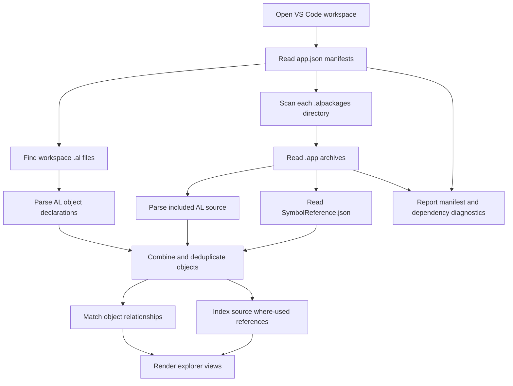
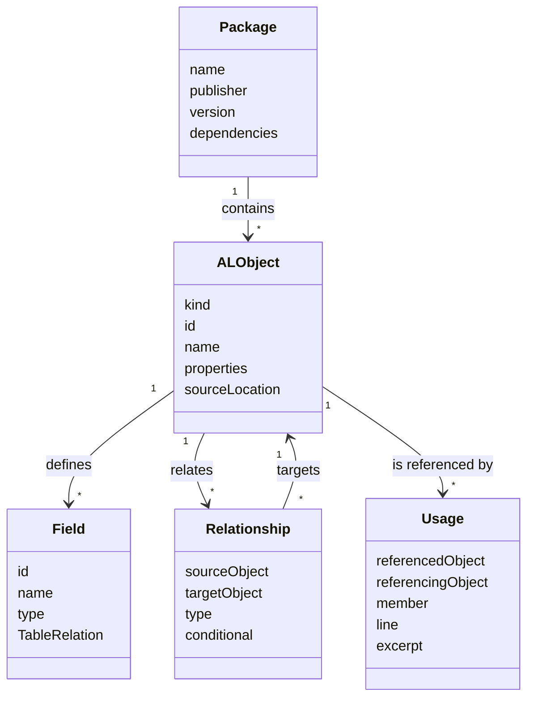
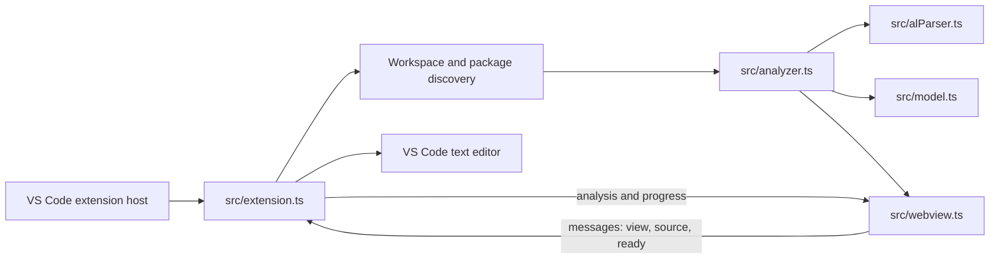

# Aardvark Labs Business Central Explorer


Business Central Explorer is a Visual Studio Code extension for learning how a
Business Central AL extension is put together and how it connects to the
objects in its installed symbol packages. It indexes AL objects in the open
workspace and the `.app` files in each workspace folder's `.alpackages`
directory, then presents object definitions, inferred relationships, and
where-used references in interactive HTML views.

The tool is designed to make dependency and source exploration easier. Its
indexes are navigation aids—not a replacement for the AL compiler, symbol
download, or Business Central runtime.

## Contents

- [What you can explore](#what-you-can-explore)
- [How the analysis works](#how-the-analysis-works)
- [Installation and first run](#installation-and-first-run)
- [Understanding the results](#understanding-the-results)
- [Architecture](#architecture)
- [Development and testing](#development-and-testing)
- [Troubleshooting](#troubleshooting)
- [Contributing and licensing](#contributing-and-licensing)

## What you can explore

| View | What it helps you investigate |
| --- | --- |
| **Overview** | The analyzed workspaces and packages, dependency coverage, object counts, and diagnostics. |
| **Relationships** | Table `TableRelation` targets around a selected table. Edge labels show the source field; solid edges are unconditional and dotted edges indicate a conditional `if` clause. Filter related tables by name or ID. |
| **Galaxy View** | Objects grouped by extension. It starts with tables and table extensions and draws extension modification (`extends`) links—not data relationships. Enable other object types, search, zoom, and pan to navigate. |
| **Tables** | Search table and table-extension definitions by name or ID. Expand an object to inspect metadata and fields, then open where-used results for a table or field. |
| **Where Used** | Review indexed references to an object or field, with source line and excerpt. Follow related-table links or open the source location. |
| **Pages** | Inspect pages and page extensions, their source-table metadata, and controls grouped by layout area/group. |
| **Reports** | Inspect reports and report extensions, including recognized properties and dataset data items. |
| **Integration Events** | Find integration-event publishers and filter by containing object or associated table. Associated tables are inferred through object relationships. |

Object detail and where-used drill-downs include **Back** actions that restore
the previous rendered view, including its filters, diagram state, and scroll
position. **View Source** opens workspace files in an editor tab. When a
dependency package contains an included `.al` source file, it opens in a
read-only virtual `.al` editor document. Symbol-only package objects do not
have source code to open.

## How the analysis works

The extension builds its index locally from the files already available in
your workspace. It does not contact Business Central or download symbols.



### 1. Discover inputs

For every open workspace folder, the extension reads `app.json` when present,
searches for `.al` files, and enumerates `.app` files directly inside
`.alpackages`. The package directory is scanned directly, so VS Code search
exclusions do not hide it. Package discovery is not recursive.

### 2. Read source and symbols

Workspace AL files are parsed as source. Each `.app` file is opened as a ZIP
archive. The analyzer reads `.al` source entries and supported
`SymbolReference.json` entries when available. A UTF-8 byte-order mark at the
start of `SymbolReference.json` is removed before JSON parsing.

AL source contains richer detail, such as source lines and excerpts. A
symbol-reference-only package can still provide object and field metadata, but
usually does not provide source text or precise source locations.

### 3. Build the object model

Recognized objects are assigned a key scoped by package, kind, and object ID.
This prevents objects with the same numeric ID in different packages from
being treated as identical. Duplicate definitions are consolidated, preferring
an object with source text when one is available.

The simplified model used by the views is:



### 4. Infer relationships and usages

The analyzer recognizes several kinds of object relationships, including:

- `TableRelation` declarations on table fields.
- Table, page, and report extension `extends` targets.
- Page/report source tables and report data items.
- AL `Record`, `RecordRef`, and `Database::` references.

Relationship matching uses the names and IDs present in the analyzed objects.
For `TableRelation`, the source field name is kept on the relationship and
conditional `if` clauses are marked for dotted display. These are static
inferences from available source and symbols; they are not compiler-resolved
database relationships.

Where-used indexing tokenizes available source and matches identifiers against
known object, procedure, and field symbols. For fields, it uses nearby table
context where the analyzer can identify it. References in symbol-only package
metadata cannot be discovered without source text.

### 5. Check dependency coverage

Declared dependencies from workspace `app.json` files are matched to available
`.app` package metadata, preferring application IDs when present and otherwise
using package name and publisher. Missing packages and detectable version
mismatches are reported as diagnostics. The extension does not fetch missing
packages or recursively resolve dependencies.

## Installation and first run

### Install a packaged VSIX

1. Obtain a release `.vsix` file.
2. In VS Code, open the Extensions view, select **…**, choose **Install from
   VSIX…**, and select the file.
3. Open a Business Central AL workspace containing `app.json` and, if needed,
   an `.alpackages` directory.
4. Select **BC Explorer** in the Activity Bar and choose a view, or run
   **Business Central Explorer: Open Overview** from the Command Palette.

You can also install from a terminal with:

```sh
code --install-extension ./business-central-explorer-0.2.4.vsix
```

### Run from source

1. Clone or open this repository in VS Code.
2. Install development dependencies and compile:

   ```sh
   npm install
   npm run compile
   ```

3. Press **F5** to launch an Extension Development Host.
4. Open an AL workspace in that host and select the **BC Explorer** Activity
   Bar icon.

The extension declares VS Code `^1.85.0` in its engine compatibility range.
The Development Host uses the workspace compiler and test scripts described
below.

## Understanding the results

### Relationship diagrams

Choose a starting table in **Relationships**. The selected table is placed in
the center; incoming and outgoing TableRelation targets are arranged in
columns on either side. A field name is shown on each connection. If multiple
fields connect the same pair of objects, their names are listed together.

| Appearance | Meaning |
| --- | --- |
| Solid line | Unconditional TableRelation found in the analyzed source. |
| Dotted line | TableRelation contains a conditional `if` clause. |

Use the related-table text filter to narrow connected tables by part of their
name or object ID. Drag the canvas to pan, use the mouse wheel to zoom, and
double-click a table node to open its details.

### Extension Galaxy

Galaxy View answers a different question from the Relationships diagram:
**which objects extend or modify other objects?** It only draws recognized
`extends` relationships between the selected object types. A table extension
connected to its base table is an example; a `TableRelation` is intentionally
not drawn here. Objects are grouped and color-coded by package. Points remain
compact until zoom or filtering makes labels legible.

### Source and read-only package files

Workspace source opens at the relevant line in the editor. If AL source was
embedded in an analyzed `.app` package, **View Source** opens that text in a
read-only virtual editor document. It does not extract or modify the package.
If only symbols are available, the source action is disabled because the
package contains no source file for that object.

### Diagnostics and progress

The Overview lists warnings and errors encountered while reading manifests,
packages, and source. The loading panel shows progress for manifest discovery,
source loading, package exploration, relationship mapping, and where-used
indexing. An unreadable package is reported with its path rather than being
silently treated as a successfully analyzed package.

## Architecture



| File | Responsibility |
| --- | --- |
| `src/extension.ts` | Registers commands and the Activity Bar view; discovers workspace inputs, reports progress, watches for changes, and opens source locations/documents. |
| `src/alParser.ts` | Parses AL object declarations and extracts supported properties, fields, page layout groups, procedures, and integration-event declarations. |
| `src/analyzer.ts` | Reads `.app` archives and symbol metadata, deduplicates objects, checks declared dependencies, builds relationships, and indexes where-used references. |
| `src/model.ts` | Defines the shared TypeScript types for objects, fields, relationships, usages, packages, diagnostics, and progress phases. |
| `src/webview.ts` | Builds the CSP-protected HTML explorer, navigation, diagrams, filters, details, and source actions. |
| `src/test/` | Contains analyzer and generated-webview regression tests. |

The extension watches AL source files, `app.json`, and `.alpackages/*.app`
files. A change schedules a fresh analysis; the explorer does not maintain a
separate database.

## Development and testing

Requirements: Node.js with npm, plus VS Code for running the Extension
Development Host.

```sh
npm install
npm run compile
npm test
```

- `npm run compile` runs the TypeScript compiler (`tsc -p ./`).
- `npm test` compiles the project and runs the Node.js test files in
  `out/test/`.
- `npm run watch` runs the TypeScript compiler in watch mode.
- `npx --yes @vscode/vsce package` compiles and packages an installable VSIX.

The tests cover AL parsing, relationship and where-used analysis, package
discovery and metadata, and the generated webview's expected markup and
behavior hooks.

## Troubleshooting

| Symptom | Things to check |
| --- | --- |
| No objects appear | Open the AL project folder in the VS Code workspace and check that its `.al` files are within the workspace. |
| A dependency is reported missing | Confirm the expected `.app` file is directly inside that workspace folder's `.alpackages` directory and that its package identity/version matches `app.json`. |
| A package appears with a diagnostic | Read the diagnostic path and message in Overview. The file may not be a readable ZIP archive or may not contain supported AL source or symbol metadata. |
| A package object's source action is unavailable | The package may contain only `SymbolReference.json`. Source navigation requires AL source text to be present in the package. |
| A relationship is absent | Relationship mapping depends on supported declarations and matching object names/IDs in the analyzed workspace and packages. This static explorer is not an AL compiler or a complete semantic resolver. |

## Contributing and licensing

Contributions should include focused tests for behavior changes. Run
`npm test` before submitting changes, and keep user-facing documentation in
sync with changes to the explorer.

**License status:** this repository currently has no `LICENSE` file. Ask the
maintainers about licensing before redistributing or using the project beyond
what copyright law otherwise permits.
